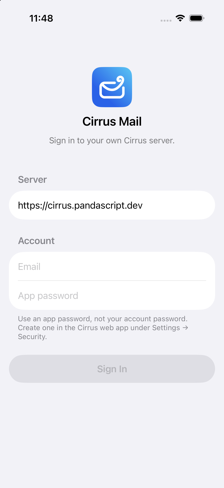

# Cirrus for iOS

A native iOS client for [Cirrus Mail](https://github.com/jackh54/cirrus-mail), the self-hosted email suite on Cloudflare Workers. It talks to the server over JMAP (RFC 8620 and 8621) and signs in with an app password.



## Features (v0.1)
- Sign in with server URL, email and app password; discovery via `/.well-known/jmap`. Credentials are kept in the Keychain only.
- Several logins and one account per mailbox, with an account switcher.
- Folders (with roles and unread counts) and labels; threaded, paginated list with pull to refresh, swipe actions and unread dots.
- Reader: HTML in a WKWebView with JavaScript off and remote images blocked until "Load images"; plain text otherwise; links open in Safari; attachments preview in QuickLook.
- Compose: new, reply, reply all and forward as plain text, with an identity picker. Sent via Email/set and EmailSubmission/set.
- Sync with Mailbox/changes and Email/changes, a JSON cache for instant launch and offline reading, EventSource while in the foreground, best-effort background refresh.
- Search with Email/query text filters. Dynamic Type, VoiceOver labels, dark mode.

## Layout
- `Packages/JMAPKit`: the protocol client (no UI), with unit tests.
- `CirrusApp`: the SwiftUI app. `project.yml` is the XcodeGen spec; `CirrusApp.xcodeproj` is committed.

## Build
Requires Xcode 26 or later (iOS 26 SDK).

```bash
xcodebuild -scheme CirrusApp -destination 'platform=iOS Simulator,name=iPhone 17 Pro' build
xcodebuild test -scheme CirrusApp -destination 'platform=iOS Simulator,name=iPhone 17 Pro'
cd Packages/JMAPKit && swift test
```

To change targets or settings, edit `project.yml` and run `xcodegen generate`. Signing is automatic with no team set: pick your team in Xcode to run on a device.

## Server
The server needs the JMAP routes (`/jmap/*`). Create an app password in the web app under Settings → Security.

## License
MIT, see `LICENSE`.
